
<a href="https://birdio.dfklabs.com"></a><a href="https://quake.dfklabs.com"></a><a href="https://studio.dfklabs.com"></a><a href="https://dfklabs.com"></a><a href="https://risu.dfklabs.com"></a><a href="https://mule.dfklabs.com"></a><a href="https://dfklabs.com/aqualateris"></a><a href="https://dfklabs.com/cue"></a><a href="https://dfklabs.com"></a><a href="https://paneltir.dfklabs.com"></a><a href="https://github.com/daifukus/vibeclauded"></a>

